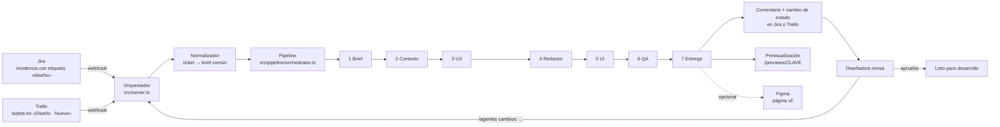

# Arquitectura

## Visión general



## Piezas

| Pieza | Dónde | Responsabilidad |
|-------|-------|-----------------|
| Servidor HTTP | `src/server.ts` | Recibe webhooks, sirve previsualizaciones y expone la API de iteración |
| Webhooks | `src/webhooks/` | Verifica la firma o el token, filtra eventos y normaliza el brief |
| Pipeline | `src/pipeline/orchestrator.ts` | Ejecuta los agentes en orden, guarda cada paso y permite relanzar desde un paso |
| Almacén | `src/pipeline/store.ts` | Estado de cada ejecución en `output/runs/<clave>/` (sustituible por una base de datos) |
| Agentes | `src/agents/` + `agents/prompts/` | Definición de cada agente y sus instrucciones en Markdown |
| Integraciones | `src/integrations/` | Jira, Trello, previsualización y Figma |
| Albora DS | `design-system/` | Única fuente de estilos que pueden usar los agentes |

## Contrato entre agentes

Cada agente recibe un objeto de contexto con el brief y las salidas de los agentes anteriores, y devuelve **JSON** con una forma fija (descrita al final de cada prompt). El orquestador valida que el JSON se pueda leer antes de pasar al siguiente paso. Si un agente falla, la ejecución se detiene en ese paso y se puede relanzar desde ahí.

## Iteración

La diseñadora comenta en el ticket empezando por `/agentes cambios:` seguido de lo que quiere cambiar. El orquestador relanza solo los agentes afectados (UX, Redactor, UI y QA) con ese comentario, guarda una nueva versión (`v1`, `v2`…) y vuelve a comentar en el ticket.

También se puede lanzar desde la terminal:

```bash
npm run iterate -- ALB-482 "Pon primero la tarifa no reembolsable"
```

## Aprobación

Aprobar es siempre una acción humana: la diseñadora mueve el ticket a «Listo para desarrollo» o comenta `/agentes aprobar`. El agente de entrega adjunta entonces la versión aprobada y su especificación.

## Despliegue recomendado

- Orquestador como función serverless o contenedor pequeño (Cloud Run, Azure Container Apps, AWS Lambda con adaptador HTTP).
- Cola de trabajos (SQS, Pub/Sub o similar) entre el webhook y el pipeline cuando haya varias peticiones a la vez: el webhook responde enseguida y el trabajo se procesa en segundo plano.
- Almacenamiento de ejecuciones en una base de datos o en un bucket en lugar de disco local.
- Previsualizaciones en un hosting estático por rama (Vercel, Netlify, Cloudflare Pages) o en el propio servidor.
